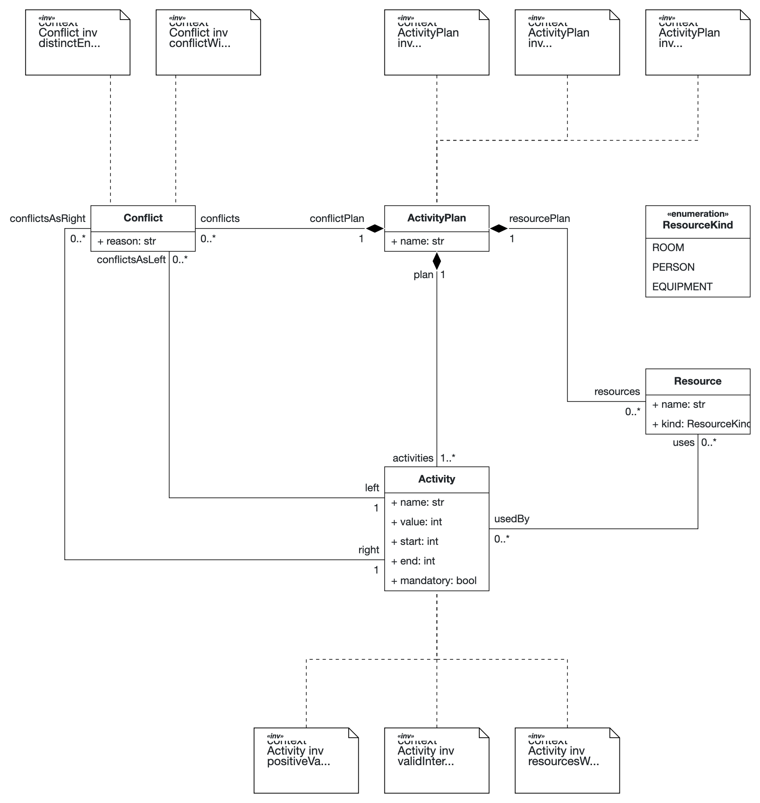
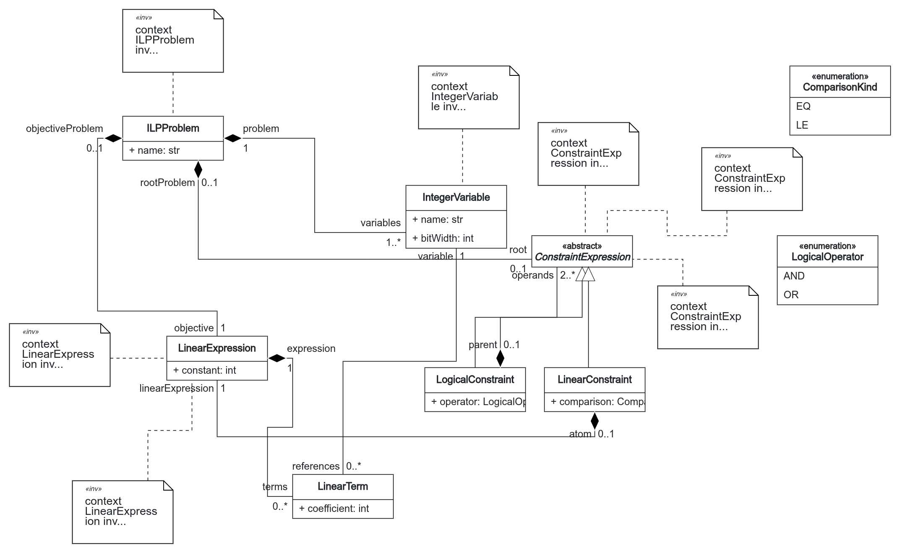

# QMDE D3: Weighted Non-Conflicting Activities

For TACS 2026/27 (FEUP M.EIC), we model the selection of non-conflicting activities
with the highest total value, a Maximum-Weight Independent Set problem. In Part I,
we define the problem DSL and a bounded integer linear programming (ILP) DSL.
In Part II, we implement the chain from problem to ILP to quantum circuit and
Qiskit code, using Grover Adaptive Search and the Aer simulator.

We chose event programmes because each activity has a value, while conflicts limit
which activities can be included together. We keep activity times fixed so that
the problem focuses on selection. Rooms, speakers and equipment are shared resources,
and activities conflict when they overlap and need the same resource. Explicit conflicts
cover other restrictions, such as activities intended for the same audience.

The metamodel should reflect what event organisers need to describe and how they
work. We use familiar concepts such as activities, rooms and speakers to reduce
the effort of expressing an event's requirements. Our aim is to make the tool
easier to learn and use, including for organisers with no knowledge of quantum
computing, and give them a reason to adopt it in their work.

Separating the Problem DSL from the Solution DSL keeps these event concepts
independent of their mathematical formulation. Following Annex A, classes C/D,
the Solution DSL uses bounded integer variables, linear constraints and a
minimisation objective. Together, the two languages provide the basis for a
translation from the organiser's problem model to the quantum program implemented
in Part II.


| Student number | Name              | GitHub        |
| -------------- | ----------------- | ------------- |
| 202207410      | Lucas Branquinho  | Lucasalf21    |
| 202104636      | Rui Martins       | Rui-Martins31 |
| 202207742      | Margarida Fonseca | gamicmf       |


# Part I: Problem and Solution DSLs

## 1. Problem DSL



The table summarises
the classes in the [B-UML metamodel](metamodels/problem_dsl.py) and
[diagram](diagrams/problem_DSL.png); the [full concept list](docs/part1/concepts.md#problem-dsl)
also includes the ILP mappings and references. Ownership is represented by composition.


| Concept      | Attributes                                         | Associations                                                                 |
| ------------ | -------------------------------------------------- | ---------------------------------------------------------------------------- |
| ActivityPlan | name: str                                          | Owns 1..\* activities, 0..\* resources and 0..\* conflicts                   |
| Activity     | name: str; value, start, end: int; mandatory: bool | Belongs to 1 plan; uses 0..\* resources; can be either endpoint of conflicts |
| Resource     | name: str; kind: ResourceKind                      | Belongs to 1 plan; used by 0..\* activities                                  |
| Conflict     | reason: str                                        | Belongs to 1 plan; references exactly 1 left and 1 right activity            |


`ResourceKind = {ROOM, PERSON, EQUIPMENT}`. We use half-open intervals `[start, end)`
so that back-to-back activities do not overlap. Mandatory activities must be selected.
We allow conflicts between mandatory activities so that a valid
problem model can describe an instance with no feasible solution.

The OCL rules add restrictions beyond the associations. `positiveValue` requires `value > 0`; `validInterval` requires
`start >= 0 and start < end`; `distinctEnds` prevents self-conflicts.
`uniqueActivityNames` and `uniqueResourceNames` require uniqueness within a plan;
`noDuplicateConflicts` forbids repeated pairs in either order; `conflictWithinPlan`
and `resourcesWithinPlan` forbid cross-plan references.

## 2. Solution DSL



The [B-UML metamodel](metamodels/solution_dsl.py) and [diagram](diagrams/solution_DSL.png)
describe the variables, constraints and objective of an optimisation problem.


| Concept                         | Attributes                 | Associations                                                                  |
| ------------------------------- | -------------------------- | ----------------------------------------------------------------------------- |
| ILPProblem                      | name: str                  | Owns 1..\* variables, 1 objective expression and 0..1 root constraint         |
| IntegerVariable                 | name: str; bitWidth: int   | Belongs to 1 problem; referenced by 0..\* terms                               |
| LinearExpression                | constant: int              | Owns 0..\* terms; belongs to exactly 1 problem objective or linear constraint |
| LinearTerm                      | coefficient: int           | Belongs to 1 expression; references 1 variable                                |
| ConstraintExpression (abstract) | None                       | Belongs to exactly 1 problem as root or logical constraint as operand         |
| LinearConstraint                | comparison: ComparisonKind | Inherits ConstraintExpression; owns 1 linear expression                       |
| LogicalConstraint               | operator: LogicalOperator  | Inherits ConstraintExpression; owns 2..\* constraint operands                 |


`ComparisonKind = {EQ, LE}` specifies whether an expression must equal zero or be
less than or equal to zero. `LogicalOperator = {AND, OR}` specifies how constraints
are combined. A variable with `w` bits ranges
from `0` to `2^w - 1`. D3 uses one bit per activity. Expressions contain integer
coefficients and constants; the objective always means minimisation.

Following Annex A, D3, we represent each activity with a variable
`y_i`, its value contributes `-value_i * y_i` to the objective, and a conflict becomes
`y_i + y_j - 1 <= 0`. A mandatory activity adds `1 - y_i = 0`. Resources and times
identify conflicts but need no separate ILP objects. We combine these constraints
with AND and retain OR to support the wider class C/D language.

For this DSL, `positiveBitWidth` requires a positive width; `uniqueVariableNames`
requires names unique within a problem. `expressionOwner` and `constraintOwner`
require exactly one of their alternative owners. `acyclicConstraints` forbids parent
cycles; `concreteConstraints` forbids direct abstract-class instances;
`variablesWithinProblem` keeps variable references inside the enclosing problem.
A problem without a root constraint has no constraints.

## 3. Hand-built models and validation

The [problem example](models/instances/medium_conference.py) contains four activities
A–D with values 3, 2, 4 and 1. A–B and B–C conflict because they overlap and use the
same room; C–D has an explicit conflict. We build the corresponding BESSER solution object model by hand in
`build_solution_example()` in [the Solution DSL tests](tests/test_solution_dsl.py):

```text
Minimise -3A - 2B - 4C - D, with A, B, C, D in {0,1}
Subject to A+B-1 <= 0, B+C-1 <= 0, C+D-1 <= 0
```

The test evaluates all 16 assignments and finds the unique optimum `{A, C}`,
with value 7 (objective −7).

The shared checker first calls `ObjectModel.validate()` for structural errors,
including multiplicities and enumeration values. It then evaluates invariants.
The checker routes three Problem DSL and two Solution DSL invariants to B-OCL.
For B-OCL compatibility, it uses Python equivalents for five rules in each
language. These rules are marked in the
[constraint tables](docs/part1/concepts.md) and selected by `BOCL_UNSUPPORTED`.
The manual fallback declarations need to be preserved when re-exporting the metamodel.

## 4. Running the checks and references

Run these commands from the repository root. `requirements.txt` installs the course's BESSER fork:

```bash
python3 -m venv .venv
source .venv/bin/activate
pip install -r requirements.txt
python -m tests.test_problem_dsl
python -m unittest tests.test_solution_dsl -v
```

The Problem script checks a valid example and 16 invalid variants; unittest discovery
does not run it. The Solution suite has 11 tests for the example and invalid models.

The formulation follows the TACS 2026/27 Assignment, draft v0.7, Annex A, classes
C/D and problem D3. We organise the concept tables following Brambilla, Cabot and Wimmer,
*Model-Driven Software Engineering in Practice*, 2nd ed., 2017, Fig. 7.4.
The event-domain choices are our own. See [concepts.md](docs/part1/concepts.md)
for detailed mappings and [LLM_USAGE_LOG.md](LLM_USAGE_LOG.md) for AI assistance.

---

# Part II: Transformations, code generation and validation

In the second part of this project, we develop the necessary transformations to convert the Problem Model into the final result that allows us to solve different scenarios using quantum circuits. The resulting quantum program is capable of selecting the non-conflicting activities with the highest aggregated value.

To find the best selection, we use Grover Adaptive Search, which runs a Grover search over and over, each round marking only the valid selections whose total value beats the best one found so far. Every time a better selection is found, a classical loop raises this threshold and builds a new circuit, stopping after a set number of rounds without improvement. Alongside that, each result is then compared with the result obtained by running the classical method, based on brute force, to assess if the generated quantum solution is correct.

## 5. The transformation chain


The search repeats circuit construction, generation and execution as it updates
the objective threshold. The final result is the best feasible selection found.


| Step                                  | Code                                                                                                      | Detailed documentation                                         |
| ------------------------------------- | --------------------------------------------------------------------------------------------------------- | -------------------------------------------------------------- |
| T1: problem → ILP                     | [problem\_to\_ilp.py](transformations/problem_to_ilp.py)                                                  | [t1.md](docs/part2/t1.md)                                      |
| T2: feasibility oracle                | [ilp\_to\_oracle.py](transformations/ilp_to_oracle.py)                                                    | [oracle.md](docs/part2/oracle.md)                              |
| T2: Grover rounds and adaptive search | [ilp\_to\_gas.py](transformations/ilp_to_gas.py), [solver\_config.py](models/solver_config.py)            | [solver\_configuration.md](docs/part2/solver_configuration.md) |
| T3: Qiskit generation and execution   | [qiskit\_executor.py](execution/qiskit_executor.py), [template](execution/templates/qiskit_circuit.py.j2) | [qiskit\_execution.md](docs/part2/qiskit_execution.md)         |
| Validation                            | [validation/](validation/)                                                                                | [validation.md](docs/part2/validation.md)                      |


## 6. T1: Problem model to ILP

T1 translates an activity plan into an ILP model using the rules below. Each activity
becomes a binary variable: 1 means selected and 0 means excluded. Activities are
sorted by name, and T1 keeps a mapping to their variables so that later stages can
assign qubits consistently and translate measured bits back into activity names.

Conflicts come either from explicit restrictions or from activities that overlap
in time and share a resource; repeated pairs produce only one constraint.
Back-to-back activities do not overlap. This leaves times and resources in the
Problem DSL, while the Solution DSL contains only the mathematical formulation.

T1 validates both models using the structural and invariant checks from Part I.
It builds the optimisation problem but does not solve it: conflicting mandatory
activities still produce a valid ILP, although no selection can satisfy it.


| Rule                    | Generated model                                               | Reference                                                  |
| ----------------------- | ------------------------------------------------------------- | ---------------------------------------------------------- |
| Activity selection      | One unsigned one-bit variable per activity                    | Annex A, class C, pp. 12–13; D3, p. 14                     |
| Maximise activity value | Minimise `-sum(value_i * y_i)`, constant 0                    | Annex A, class D/D3, pp. 13–14                             |
| Conflict                | `y_i + y_j - 1 <= 0`                                          | Annex A, D3, p. 14                                         |
| Mandatory selection     | `1 - y_i = 0`                                                 | Class C equality-atom syntax, pp. 12–13; event-domain rule |
| Conjunction             | No root for zero atoms; the atom for one; AND for two or more | Class C conjunction, pp. 12–13                             |


## 7. T2: ILP to quantum circuit

### 7.1 Feasibility oracle

The oracle uses one qubit per activity, following the order established by T1,
and a separate scratch register for each constraint. We size each register to
hold every possible value of its expression in two's complement, following
Annex A, class C. For an inequality `e <= 0`, we store `e - 1`: the constraint
holds when that value is negative, so we can check its sign bit. For an equality
`e = 0`, we check whether all bits in the register are zero.

The circuit computes these values using QFT-based addition, applies a phase flip
to selections that satisfy every constraint, and reverses the arithmetic to
return the scratch registers to zero. We chose to use this same arithmetic
approach for every constraint, including conflicts. This keeps the construction
consistent, but costs two scratch qubits per conflict or mandatory activity and
limits the instances we can simulate (§9). We tested the oracle against the
classical constraints for every assignment of the hand-checked example. We also
checked that the validation tests fail if we remove uncomputation, omit the
inequality shift or reverse the qubit order.


| Step      | What it does                                                          | Reference             |
| --------- | --------------------------------------------------------------------- | --------------------- |
| Width     | smallest B with −2^(B−1) ≤ min and max ≤ 2^(B−1) − 1                  | Annex A, class C      |
| Compute   | add `e − 1` (LE) or `e` (EQ) into the register with QFT + phase gates | Draper (2000)         |
| Compare   | LE: sign bit is 1. EQ: all bits are 0                                 | Gilliam et al. (2021) |
| Mark      | one multi-controlled Z over all atom flags                            | Annex A, class C      |
| Uncompute | same additions with negative angles                                   | Bennett (1973)        |


### 7.2 Grover rounds and adaptive search

Each round starts with a uniform superposition of activity selections, applies
`k` repetitions of the oracle and diffusion on the activity qubits, then measures
them. Until a feasible selection is found, the oracle marks all feasible selections.
Afterwards, with best objective `t`, it adds `g(y) - t + 1 <= 0` to mark only strict
improvements. The classical loop checks each sampled selection and updates `t`
only for a better feasible result, rebuilding the oracle for the next round.

The adaptive policy chooses `k` randomly from zero up to the rounded-down window
size, excluding that upper bound. The window grows after unsuccessful rounds and
resets after an improvement. This varies the search effort because the number of
marked selections is unknown. The configuration below controls this policy and
the stopping limits. The search returns the best selection found, decoded through
T1's mapping; reaching a limit proves neither optimality nor infeasibility.


| Solver configuration field                      | Default ([gas\_defaults.py](models/gas_defaults.py)) |
| ----------------------------------------------- | ---------------------------------------------------- |
| `round_policy`                                  | `adaptive` (`fixed` also supported)                  |
| `initial_window`, `growth_factor`, `max_window` | 1, 1.2, 16                                           |
| `max_rounds`, `max_rounds_without_improvement`  | 100, 20                                              |
| `shots`, `seed`, `backend`                      | 1, 42, `aer_simulator`                               |


## 8. T3: Qiskit code generation

T3 turns the BESSER circuit into executable Qiskit Python code. For the pinned
BESSER revision, the project supplies a repository-owned template and a
controlled-phase gate mapping through a generator subclass. The remaining
gates use BESSER's existing mappings. We pin the BESSER revision and restrict Qiskit
to 2.x to retain compatibility with the generator's legacy `QFT` class.

Each search round generates fresh code and runs it on Aer with the configured
shot count and a new execution seed drawn from the configured random sequence,
without manual edits to the generated file. The sampler converts measurement
counts into bit tuples in T1 order before returning them to the search loop.
T1's mapping connects the result to activity names. The final output reports the best selection
found and its total value, or states that no feasible selection was found within
the search budget.

## 9. Test instances and classical baseline

The repository also contains other small Problem DSL models. Their exact optima
are obtained by enumerating all `2^n` activity selections, discarding selections
that omit a mandatory activity or contain a conflict and maximising total value.
Conflicts include both explicit conflicts and overlapping uses of a shared resource.
The minimisation objective of the corresponding ILP is the negative of the value.


| Model                                                            | Activities | Conflicts | Feasible selections | Exact optimum     | Optimal selections                                                          | Peak qubits |
| ---------------------------------------------------------------- | ----------: | ---------: | -------------------: | -----------------: | --------------------------------------------------------------------------- | -----------: |
| [tiny\_workshop](models/instances/tiny_workshop.py)              | 3          | 1         | 6                   | 3                 | `{A, C}`                                                                    | 8           |
| [infeasible\_retreat](models/instances/infeasible_retreat.py)    | 4          | 1         | 0                   | None (infeasible) | None; Keynote and Board are mandatory and conflict                          | 10          |
| [multi\_optima\_sports](models/instances/multi_optima_sports.py) | 5          | 2         | 18                  | 6                 | `{Tennis1 or Tennis2, Padel or Basketball, Stretching}` (four combinations) | 14          |
| [medium\_conference](models/instances/medium_conference.py)      | 4          | 3         | 8                   | 7                 | `{A, C}`                                                                    | 15          |
| [large\_open\_day](models/instances/large_open_day.py)           | 9          | 2         | 96                  | 12                | all except `RoboticsDemo` and `CampusWalk`                                  | 20          |


Peak qubits is the largest GAS circuit built during the search: one qubit per activity, a
register per conflict or mandatory activity and, after the first round, the objective
threshold register. Each conflict costs a 2-qubit register, so the instances are sized to
stay within the ~20-qubit simulation limit of Annex A. In this case, `medium_conference` is the hand-checked
example of Section 3.

<!-- > ✍️ **TODO(report): a few sentences on how the instances were chosen.** Facts to cover:
> - Annex A asks for a tiny instance, a medium one, one near ~20 qubits, one with several
>   optima and one with none; this set covers all five.
> - The first versions of medium/large needed 27 qubits and did not finish simulating.
>   We reduced conflicts and values instead of changing the transformations, and renamed
>   the old tiny example (15 qubits) to medium. -->

As asked in Annex A, a set of five different test cases is presented, where each one covers a different case: three of them differ from each other in size (8, 15 and 20 qubits), while the remaining two differ because they either have no feasible selection or, instead, have more than one optimal solution. Together, they check that: the chain stays correct as the size grows, that any of several optima is accepted and that nothing is reported when no feasible selection exists.

Initially, both the medium and the large test cases exceeded the suggested limit of about 20 qubits, which required us to redesign them. To downsize those test cases, we opted for the removal of some conflicts and smaller activity values (which shrink the threshold register), so that the transformations did not need to change. We also turned the previous tiny example into the medium one and added a new tiny instance.

## 10. Validation results

Full method, tables and observations: [docs/part2/validation.md](docs/part2/validation.md).

**Amplification check.** One Grover round with k iterations on the generated circuit,
2048 shots, against the ideal `P(k) = sin²((2k+1)θ)`, `sin θ = √(M/N)`, with M (marked
selections) from the baseline. Optimal selections marked, best k:


| Instance                  | M / N | k   | Ideal P(k) | Measured |
| ------------------------- | -----: | ---: | ----------: | --------: |
| tiny                      | 1/8   | 2   | 0.945      | 0.936    |
| multi\_optima             | 4/32  | 2   | 0.945      | 0.945    |
| medium                    | 1/16  | 3   | 0.961      | 0.958    |
| large                     | 1/512 | 17  | 0.999      | 0.999    |
| infeasible (valid marked) | 0/16  | 0–1 | 0.000      | 0.000    |


**Grover Adaptive Search**, 10 seeds per instance, default solver configuration.
Oracle calls = Σ over rounds of k × shots.


| Instance      | Qubits | Brute force 2^n | Optimum found         | Oracle calls to answer (median) | Oracle calls total (mean) | Rounds (mean) |
| ------------- | ------: | ---------------: | ---------------------: | -------------------------------: | -------------------------: | -------------: |
| tiny          | 8      | 8               | 10/10                 | 0                               | 60.6                      | 25.9          |
| infeasible    | 10     | 16              | 10/10 (none reported) | 0                               | 63.8                      | 20.0          |
| multi\_optima | 14     | 32              | 10/10                 | 0                               | 62.4                      | 24.5          |
| medium        | 15     | 16              | 10/10                 | 0                               | 60.7                      | 28.9          |
| large         | 20     | 512             | 10/10                 | 29                              | 93.3                      | 54.7          |


The measured amplification probabilities are close to the theoretical values,
within sampling error. This gives us confidence that the oracle, diffusion and
qubit ordering work together as intended. In our ten seeded GAS runs per instance,
every feasible instance returned an exact optimum. The infeasible instance never
returned a selection, although that observation alone does not prove infeasibility.

For the smaller instances, the median number of oracle calls before finding the
answer was zero. The search starts with `k = 0`, and random sampling was often
enough to find an optimum in these small search spaces. For the large instance,
the median was 29 calls before finding the answer; exhaustive enumeration checks
512 candidates. Most of the remaining calls came from the stopping period. These
small experiments do not demonstrate a practical quantum advantage.

The tiny instance also illustrates over-rotation: one Grover iteration reduces
the probability of a valid selection from 0.75 to 0. We vary the number of
iterations because we do not know how many selections are marked in advance.

## 11. Limitations

Stopping after a limited number of rounds does not prove that the best selection
found is optimal, or that an instance is infeasible. For these examples, we rely
on exhaustive classical enumeration to establish the exact answer. The scratch
registers also make larger instances expensive: each conflict or mandatory
activity uses two qubits, and the threshold needs another register. We therefore
kept our instances within roughly 20 qubits, making them easy to solve classically.

We ran the experiments on an ideal simulator, without noise, and did not optimise
circuit depth or run on real quantum hardware. With only ten seeds per instance,
the measured success rates are also rough estimates. Finally, the generated code
uses Qiskit's deprecated `QFT` class, so we restrict the dependency to Qiskit
2.x; the class is removed in Qiskit 3.

## 12. Running Part II

```bash
python run_gas.py --instance tiny            # one instance, result in domain terms
python run_gas.py --help                     # lists the instances
python -m validation.classical_baseline      # exact optima by brute force (table in §9)
python -m validation.qubit_count             # circuit sizes
python -m validation.quantum_vs_classical    # validation tables; --skip-gas omits GAS runs
python -m pytest -q -W ignore                # all tests
python -m tests.test_problem_dsl             # Problem DSL checks (not found by test discovery)
```

Run in the activated project environment. Runtime depends on hardware, dependency
versions, instance size and solver configuration. For setup and conditional Aer
import troubleshooting, see [Qiskit execution](docs/part2/qiskit_execution.md).

<!-- ### References (Part II)

- C. Dürr, P. Høyer, *A quantum algorithm for finding the minimum*, arXiv:quant-ph/9607014, 1996.
- M. Boyer, G. Brassard, P. Høyer, A. Tapp, *Tight bounds on quantum searching*, Fortschritte der Physik 46, 1998.
- A. Gilliam, S. Woerner, C. Gonciulea, *Grover Adaptive Search for Constrained Polynomial Binary Optimization*, Quantum 5, 428, 2021.
- T. Draper, *Addition on a quantum computer*, arXiv:quant-ph/0008033, 2000.
- C. H. Bennett, *Logical reversibility of computation*, IBM J. Res. Dev. 17, 1973.
- M. Nielsen, I. Chuang, *Quantum Computation and Quantum Information*, 10th anniversary ed., 2010, §6.1.
- TACS 2026/27 Assignment, draft v0.7: §7 and Annex A (classes C/D, problem D3). -->
